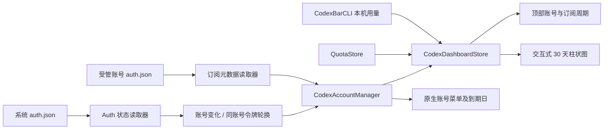

# Spec: Codex 订阅周期、账号同步与用量图表交互修复

状态：待用户确认后实施
日期：2026-08-11

## Objective

在不增加手工备注、不引入新的第三方依赖、不依赖未公开网络接口作为主路径的前提下，完成以下改进：

1. 自动读取每个 Codex 账号的当前订阅周期开始时间、有效期和最后核验时间。
2. 当前账号切换或同一账号令牌更新后，账号、额度、订阅日期和菜单选中状态保持一致。
3. 在 300pt 宽的菜单顶部紧凑显示当前订阅周期，并在账号列表中快速显示到期日。
4. 让 30 天柱状图支持悬停详情、点击固定和零值柱命中。
5. 临时读取失败时保留最后一次有效数据，不闪回 0、99、100 或错误账号内容。

## Confirmed Assumptions

1. `chatgpt_subscription_active_start` 表示当前订阅/权益周期开始，不表述为历史首次购买时间。
2. `chatgpt_subscription_active_until` 表示当前权益有效期结束，可显示为“有效至”。
3. 当前机器的系统账号和 4 个受管账号均存在上述字段，但这些字段不是公开稳定 API，解析必须允许缺失和格式变化。
4. 本机 Token/费用仍然是设备级估算，不声称属于某一个账号，也不声称是订阅账单。
5. 继续保持 Codex-only、macOS 14+、Apple Silicon、300pt 菜单宽度和原生账号菜单交互。

## Non-Goals

- 不展示或推断历史首次购买日期。
- 不把 `ManagedCodexAccount.createdAt` 当作会员开通日期。
- 不复制 Cockpit Tools 源码。
- 本阶段不把 `/backend-api/accounts/check` 或 `/backend-api/subscriptions` 作为正常数据源。
- 不增加 Claude、Gemini 或其他平台入口。
- 不把设备级 Token 历史拆分成未经证实的账号账单。

## Data Model

新增独立于额度窗口的账号级模型，避免把订阅周期塞进 5 小时/周额度状态：

```swift
struct CodexSubscriptionMetadata: Codable, Equatable, Sendable {
  let activeStart: Date?
  let activeUntil: Date?
  let lastChecked: Date?
  let source: Source
  let freshness: Freshness
}
```

`Source` 至少区分 `idToken`、`quotaFallback`；`Freshness` 至少区分 `fresh`、`cached`、`unknown`。到期状态由当前时间动态计算，不持久化为容易过期的布尔值：

- `active`：距离到期超过 7 天。
- `expiringSoon`：剩余 1～7 天。
- `expiresToday`：当地日历当天到期且尚未过期。
- `expired`：`activeUntil <= now`。
- `unknown`：没有可信结束日期。

数据来源优先级：

1. 当前账号使用实时 `~/.codex/auth.json` 的 ID Token claim。
2. 非当前账号使用各自 `managedHomePath/auth.json` 的 ID Token claim。
3. 当前账号本地 claim 缺失时，使用现有 `QuotaSnapshot.subscriptionRenewsAt / subscriptionExpiresAt` 作为兼容回退。
4. 本轮运行中解析失败时保留该账号上一次有效的派生日期。
5. 所有来源均缺失时显示“订阅日期未知”，不生成假日期。

## Data Flow



## Detailed Changes

### 1. JWT 与订阅元数据读取

- 新增 `CodexSubscriptionMetadata.swift`，集中处理 Base64URL payload、namespaced claim 和日期解析。
- 复用 `CodexOAuthCredentialsStore` 取得 `idToken`，不自行保存 access token 或 refresh token。
- 同时支持 ISO-8601 时区偏移、带/不带小数秒，以及未来可能出现的秒/毫秒时间戳。
- 优先读取 `https://api.openai.com/auth` 字典中的字段，并为同名顶层字段保留兼容路径。
- 发现结束时间早于开始时间时视为无效范围，只保留可独立验证的字段。
- 错误对象和日志只包含“字段缺失/格式无效”，永远不包含 token、payload 或认证文件正文。

### 2. 同账号令牌轮换监控

把当前只比较账号 ID/邮箱的 `CodexAuthIdentity` 扩展为不泄露凭据的状态签名：身份信息 + auth 文件 SHA-256 指纹 + 订阅元数据。

变化类型分为：

- `accountChanged`：账号 ID 或邮箱变化。重新加载账号状态，清除旧账号额度后刷新。
- `credentialsRotated`：身份不变但文件指纹变化。重新读取订阅日期并刷新额度，但保留当前成功快照直到新结果返回。
- `metadataChanged`：订阅字段变化。只发布新的账号元数据，并按需刷新额度。

手动账号切换成功后调用监控器的 `acceptCurrentState()`，避免 5 秒后再次识别为外部切换并重复取消请求。

### 3. 受管账号副本同步

切换离开当前账号前，将实时 `auth.json` 原子同步回该账号的受管目录：

1. 用账号 ID/邮箱验证实时凭据确实属于当前保存账号。
2. 使用临时文件 + 原子替换写入受管 `auth.json`。
3. 强制文件权限 `0600`、目录权限 `0700`。
4. 更新该账号的凭据指纹和 `updatedAt`，保留原始 `createdAt`。
5. 再验证目标账号并原子替换系统凭据。
6. 目标验证失败时恢复原系统凭据；已同步的当前账号备份可以保留，因为它是更新后的可信副本。

这样 Codex 自动刷新过的 ID Token、订阅周期和 refresh token 不会在下一次切换回来时被旧副本覆盖。

### 4. 账号级状态发布

`CodexManagedAccountViewModel` 增加 `subscription`，`CodexAccountManager` 增加 `currentSubscription`：

- 当前账号始终优先读取实时认证文件。
- 非当前账号读取各自受管认证文件。
- 单个账号解析失败不能导致整个账号列表清空。
- 使用账号 UUID 保存本轮运行的最后有效元数据；失败时标为 `cached`。
- 外部 Codex 登录变化后同时更新账号勾选状态、顶部邮箱和订阅周期。

`CodexDashboardStore` 订阅 `CodexAccountManager`，统一发布当前账号显示模型。额度请求仍由 `QuotaStore` 管理，不复制其刷新逻辑。

### 5. 刷新与竞态控制

账号切换顺序固定为：

1. 生成新的切换代次并取消旧额度请求。
2. 将 UI 进入“正在切换”，额度显示 `--`，不展示旧账号数值。
3. 同步当前账号受管副本。
4. 原子切换并验证目标身份。
5. 立即发布目标邮箱、选中状态和本地订阅日期。
6. 启动目标账号额度刷新；仅当前代次结果可以写入。
7. 切换失败时恢复原账号、原订阅元数据和原额度快照。

同账号令牌轮换不清空现有额度，只在后台替换成功结果。设备级本机用量不会因账号切换而清空；它只在启动、定时或手动刷新时更新。

### 6. 顶部订阅周期布局

顶部账号区域改为两部分，保持单一卡片和 300pt 宽度：

```text
◉ Codex                         user@example.com
  1分钟前更新                   prolite
  本期 07/26–08/26              剩余15天
──────────────────────────────────────────────
每周
```

- 周期行固定存在；未知时显示“订阅周期未知”。
- 主文本 `11–12pt`、等宽数字、单行显示，高度约 `18pt`。
- 正常使用蓝绿色，7 天内橙色，已到期红色，未知灰色。
- `lastChecked` 只放在 tooltip/辅助说明中，不占主界面高度。
- 移除当前右侧 VStack 中第三行“到期”文本，避免邮箱列被继续撑高。
- 通过压缩现有上下 padding 和使用 `NSHostingView.fittingSize` 消除固定 450pt 空白；最终宽度保持 300pt，Dashboard 高度不超过当前 450pt。

### 7. 账号列表到期速览

继续使用原生 `NSMenuItem`，不把账号列表改成容易影响键盘导航和点击的多行自定义视图。

- 标题格式：`压缩后的邮箱 · 08/26`、`压缩后的邮箱 · 已到期` 或 `压缩后的邮箱 · 日期未知`。
- 长邮箱按实际菜单字体宽度做中间截断，确保标题和日期在 300pt 菜单内完成单行显示。
- `toolTip` 显示完整邮箱、完整周期、剩余天数和最后核验时间。
- 当前账号继续使用系统勾选状态；账号操作期间仍禁用切换。
- 临近到期或已到期可以为日期后缀设置系统橙色/红色，但必须在菜单选中高亮下保持可读。

### 8. 交互式 30 天柱状图

保持现有 `Chart + BarMark`，新增一个覆盖整个 plot area 的透明命中层，不给每根细柱单独挂手势。

状态模型：

```swift
@State private var hoveredDayID: String?
@State private var pinnedDayID: String?
```

有效选择为 `pinnedDayID ?? hoveredDayID`：

- 鼠标进入：根据横坐标映射最近日期，立即高亮柱子。
- 鼠标移动：更新悬停日期，零值柱也可以命中。
- 鼠标离开：清除临时悬停；已点击固定的日期继续保留。
- 单击柱子：固定 tooltip；再次单击相同柱或单击空白处取消。
- 刷新后如果对应日期仍存在则保留固定选择，否则自动清除。

Tooltip 内容只显示有值字段：

```text
8月10日
Token 18.4M
预估费用 US$5.62
主要模型 gpt-5.6-sol
```

- Tooltip 使用 `10–11pt` 字体、小圆角和轻阴影，限制在图表边界内，不推动其他内容。
- 选中柱使用 100% accent，其余柱降至约 40%；动画控制在 120–160ms，并尊重“减少动态效果”。
- Tooltip 明确写“预估费用”，不让本机估算看起来像真实账单。
- 为图表和选择结果补充 accessibility label/value。

### 9. 未公开接口的处理

本阶段保留 `CodexSubscriptionMetadataProviding` 协议，主实现只有本地 ID Token reader。若未来确认存在大量没有 claim 的真实账号，再单独评估 Cockpit 使用的接口，并要求：

- 仅在本地字段缺失时调用。
- 账号/组织 ID 精确匹配。
- 30 分钟失败退避。
- 永不以失败结果覆盖最后成功日期。
- 接口变化只导致“日期未知”，不能影响额度主功能。

## Project Changes

- 新增 `Sources/QuotaFloat/CodexSubscriptionMetadata.swift`：模型、JWT reader、日期和状态计算。
- 修改 `Sources/QuotaFloat/CodexAuthMonitor.swift`：状态指纹、变化分类和 baseline 同步。
- 修改 `Sources/QuotaFloat/CodexAccountManager.swift`：账号元数据、当前订阅和受管副本回写。
- 修改 `Sources/QuotaFloat/CodexDashboardStore.swift`：聚合当前账号订阅状态。
- 修改 `Sources/QuotaFloat/CodexDashboardView.swift`：紧凑周期行与交互式图表。
- 修改 `Sources/QuotaFloat/StatusBarQuotaController.swift`：账号标题、tooltip、菜单自适应高度和刷新生命周期。
- 修改 `Sources/QuotaFloat/AppDelegate.swift`：认证变化分类后的刷新协调。
- 新增订阅 reader、监控、账号同步、格式化和图表选择状态测试。

## Testing Strategy

### Unit Tests

1. JWT：有效 namespaced claim、顶层兼容、Base64URL padding、损坏 token、缺失字段。
2. 日期：时区偏移、小数秒、无小数秒、秒/毫秒时间戳、结束早于开始。
3. 状态：超过 7 天、7 天内、今日到期、刚过期、未知日期和夏令时边界。
4. 安全：任何错误文本不包含 token 或 payload 片段。
5. Auth monitor：账号变化、同账号 token 轮换、只有元数据变化、baseline 同步后不重复通知。
6. Account manager：当前账号读取 live 文件、非当前账号读取 managed 文件、单账号损坏不清空列表。
7. 账号切换：离开前同步实时凭据、权限正确、目标失败回滚、旧请求不能覆盖新账号。
8. 菜单格式：长邮箱中间截断、日期后缀、未知和已到期状态。
9. 图表状态：hover、pin、再次点击取消、空白取消、刷新后选择失效。

所有测试使用合成 JWT 和临时目录，禁止读取或写入真实用户 token。

### Integration and Runtime Tests

1. 连续快速切换至少 20 次，邮箱、勾选、订阅日期和额度始终属于同一账号。
2. 修改同一账号的合成 ID Token，5 秒监控周期内只触发一次正确刷新。
3. 断网或模拟 401/超时，最后成功额度和订阅日期仍保留并标记过期状态。
4. 在安装后的菜单中逐个悬停 30 根柱子，包括 0 值柱；点击固定和取消均可用。
5. 300pt 菜单在最长邮箱、中文状态和日期下无换行、遮挡或横向扩张。
6. 开机启动状态、菜单栏按钮点击、退出和单实例行为无回归。

## Commands

- 格式检查：`swift format lint --recursive --strict Sources Tests`
- 测试：`swift test --parallel`
- 自检：`swift run QuotaFloat --self-test`
- Release 构建：`swift build -c release --product QuotaFloat`
- 应用打包：`./Scripts/package_app.sh`
- 签名验证：`codesign --verify --deep --strict dist/codex额度显示器.app`
- 架构验证：`lipo -archs dist/codex额度显示器.app/Contents/MacOS/QuotaFloat`
- 安装后启动：`open -n /Applications/codex额度显示器.app`

## Implementation Order

1. 先用合成数据锁定 JWT、日期、状态和认证变化分类。
2. 接入账号级订阅元数据，但暂不改变 UI。
3. 修复实时凭据回写和同账号令牌轮换，完成账号切换回归。
4. 接入 Dashboard 当前周期行和账号菜单日期。
5. 实现图表 hover/click 命中层和 tooltip。
6. 调整菜单自适应高度与紧凑间距，完成视觉 QA。
7. 执行完整测试、打包、签名、安装和真实运行验证。

## Success Criteria

1. 有 claim 的所有已保存账号启动后自动显示本期和有效期，无需手工输入。
2. 当前账号顶部显示完整周期与剩余天数；账号列表单行显示到期日。
3. 同账号令牌更新后 5 秒内更新日期，不清空现有成功额度。
4. 账号切换后邮箱、勾选、订阅日期和额度一致；迟到请求不能污染当前账号。
5. 暂时失败时不闪成 0、99、100，也不显示其他账号数据。
6. 30 天柱状图悬停有详情、点击可固定、零值柱可命中，且菜单不会意外关闭。
7. Dashboard 宽度保持 300pt，高度不超过当前 450pt，文字不换行或遮挡。
8. 不输出、不缓存原始 token；不调用外部分析服务。
9. 格式、测试、自检、Release、签名和安装后运行验证全部通过。

## Risks and Mitigations

- 未公开 claim 消失：显示未知并保留兼容回退，不影响额度刷新。
- claim 语义变化：UI 固定使用“本期/有效至”，不宣称首次购买。
- 同账号 token 频繁轮换：指纹变化去重，刷新任务使用代次隔离。
- 菜单内 SwiftUI hover 事件异常：统一 plot overlay，并在安装后的真实 NSMenu tracking 环境验证。
- 长邮箱撑宽菜单：按字体测量中间截断，完整值放 tooltip。
- 受管凭据覆盖风险：每次写入前后验证身份、原子替换、失败回滚和权限检查。

## Boundaries

- Always：按账号隔离、原子写入、失败保留最后成功值、使用合成凭据测试。
- Ask First：启用未公开网络接口、改变现有账号存储格式、升级 CodexBar 固定提交。
- Never：记录真实 token、把账号添加时间冒充购买时间、复制许可不兼容源码、用占位值冒充真实数据。

## Open Questions

无阻塞问题。默认按“本地 claim 优先、私有接口暂不启用、原生单行账号菜单”实施。
